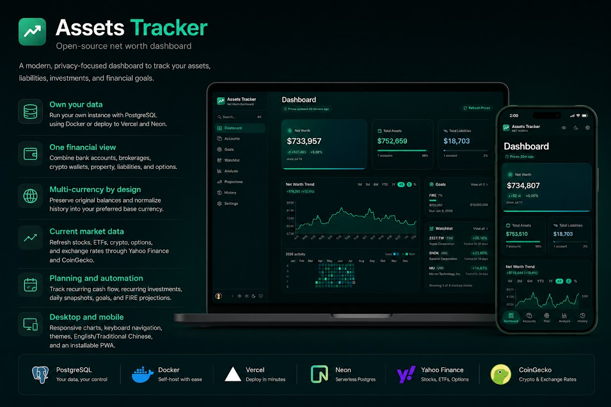
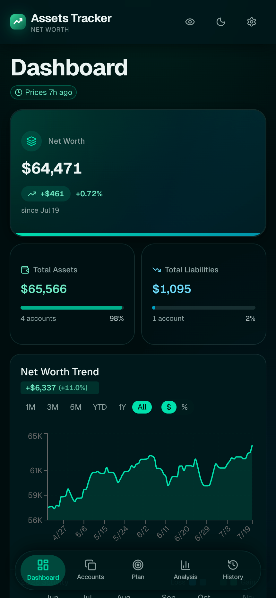

# astt

[](https://github.com/mike840609/assets_tracker/actions/workflows/ci.yml)
[](https://github.com/mike840609/assets_tracker/actions/workflows/e2e.yml?query=branch%3Amaster+event%3Apush)
[](https://github.com/mike840609/assets_tracker/releases/latest)
[](https://github.com/mike840609/assets_tracker/pkgs/container/assets_tracker)
[](./LICENSE)
[](./.github/CONTRIBUTING.md)
[](https://deepwiki.com/mike840609/assets_tracker)

[English](./README.md) | [简体中文](./README.zh-CN.md) | [繁体中文](./README.zh-TW.md)

**开源、可自行部署的净资产与投资组合追踪工具。**

支持多币种，让你集中追踪净资产、投资、现金、不动产、负债与长期财务目标，同时保有自己的数据控制权。

> 原名 Assets Tracker，为同一个项目，现以 **astt** 作为品牌名。

[在线演示](https://astt.app) · [快速开始](#快速开始) · [用 AI 安装](#用-ai-安装) · [文档](#文档) · [安全政策](./.github/SECURITY.md) · [参与贡献](./.github/CONTRIBUTING.md)



## 为什么选择 astt？

- **数据由你掌控** — 可通过 Docker 与 PostgreSQL 自行部署，也可使用 Vercel 与 Neon。
- **统一财务视图** — 整合银行、券商、加密钱包、不动产、负债与期权仓位。
- **原生多币种支持** — 保留原始余额与币种，并使用偏好的基准币种查看历史数据。
- **实时市场数据** — 从支持的数据源更新股票、ETF、加密货币、期权与汇率。
- **规划与自动化** — 支持定期收支、定投、每日快照、财务目标以及 FIRE 测算。
- **桌面与移动设备适配** — 响应式界面、主题切换、英文/中文以及可安装 PWA。

## 操作展示

<table>
  <tr>
    <th width="70%">桌面端</th>
    <th width="30%">移动端</th>
  </tr>
  <tr>
    <td></td>
    <td></td>
  </tr>
</table>

[在线演示](https://astt.app) 使用 [`src/lib/demo/demo-data.json`](./src/lib/demo/demo-data.json) 这份示例数据。在「设置 → 从备份还原」中导入该文件，即可在你自己的站点加载相同的示例投资组合。

## 快速开始

如需自行正式部署，可以直接使用 Docker Compose：

```bash
./scripts/setup-env.sh   # 生成 .env 和各类密钥
docker compose --profile full up --no-build -d
```

脚本会输出登录密码。该脚本不会覆盖已存在的 `.env` 文件；只要任意密钥还是 `.env.example` 里的占位字符串，应用就无法启动。

环境变量、HTTPS、备份、升级、Vercel + Neon 以及其他正式部署相关细节，请参考[部署与自托管](./docs/DEPLOYMENT.md)。

想要在本地开发 astt？请查阅[开发流程](./docs/DEVELOPMENT.md)。

## 通过 AI 安装

想交由 AI 代码助手完成安装？将下面的提示词发给你的 AI 助手：

> 请按照指引安装 astt：https://raw.githubusercontent.com/mike840609/assets_tracker/master/docs/INSTALL_WITH_AI.md

该指引包含本地开发以及正式自托管两种场景。

## 工具对比

<details>
<summary><b>astt 与 Ghostfolio、Firefly III、Actual Budget 的对比</b></summary>

astt 专注于净资产与投资追踪。如果你主要需要复式记账或者信封预算，[Firefly III](https://github.com/firefly-iii/firefly-iii) 和 [Actual Budget](https://github.com/actualbudget/actual) 会是不错的选择——下面是各个工具的定位：

|                                     | astt              | [Ghostfolio](https://github.com/ghostfolio/ghostfolio) | [Firefly III](https://github.com/firefly-iii/firefly-iii) | [Actual Budget](https://github.com/actualbudget/actual) |
| ----------------------------------- | ----------------- | ------------------------------------------------------ | --------------------------------------------------------- | ------------------------------------------------------- |
| 核心定位                            | 净资产 + 投资追踪  | 投资组合管理                                           | 记账与预算管理                                            | 信封式预算                                              |
| 实时行情数据（股票、ETF、加密货币） | ✅                | ✅                                                     | —                                                         | —                                                       |
| 期权持仓                            | ✅                | —                                                      | —                                                         | —                                                       |
| 多币种账户与历史记录                | ✅                | ✅                                                     | ✅                                                        | —                                                       |
| 定期规则                            | ✅ 现金 + 定期定投 | —                                                      | ✅ 现金                                                   | ✅ 现金                                                 |
| 目标与FIRE测算                      | ✅                | ✅                                                     | —                                                         | —                                                       |
| 预算/复式记账                       | —                 | —                                                      | ✅                                                        | ✅                                                      |
| 许可协议                            | MIT               | AGPL-3.0                                               | AGPL-3.0                                                  | MIT                                                     |

<sub>整理自各项目2026年7月公开文档，最新功能请以各项目官网为准。</sub>

</details>

## 文档

- [借助AI代理安装](./docs/INSTALL_WITH_AI.md)
- [部署与自建托管](./docs/DEPLOYMENT.md)
- [开发流程](./docs/DEVELOPMENT.md)
- [架构说明](./docs/ARCHITECTURE.md)
- [数据库与迁移脚本](./docs/DATABASE.md)
- [CI规范](./docs/CI.md)
- [版本管理](./docs/VERSIONING.md)
- [环境变量参考](./.env.example)

## 支持与安全说明

你可以通过 [GitHub Issues](https://github.com/mike840609/assets_tracker/issues) 提交可复现的bug或者功能建议。安全漏洞请按照[安全政策](./.github/SECURITY.md)私下提交。

## 数据责任声明

astt 属于个人财务追踪软件，不构成财务、税务或投资建议。自行部署的用户需要自行负责部署环境、数据、备份、密钥以及访问权限的安全。

## 许可协议

本项目基于 [MIT License](./LICENSE) 开源，© 2026 Mike Tsai。
